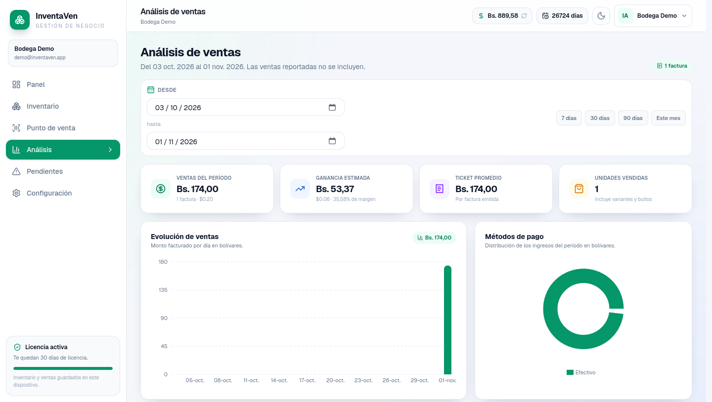
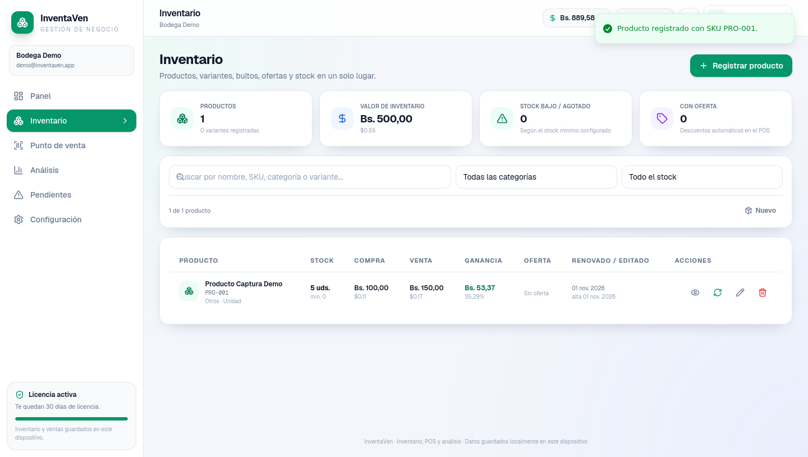
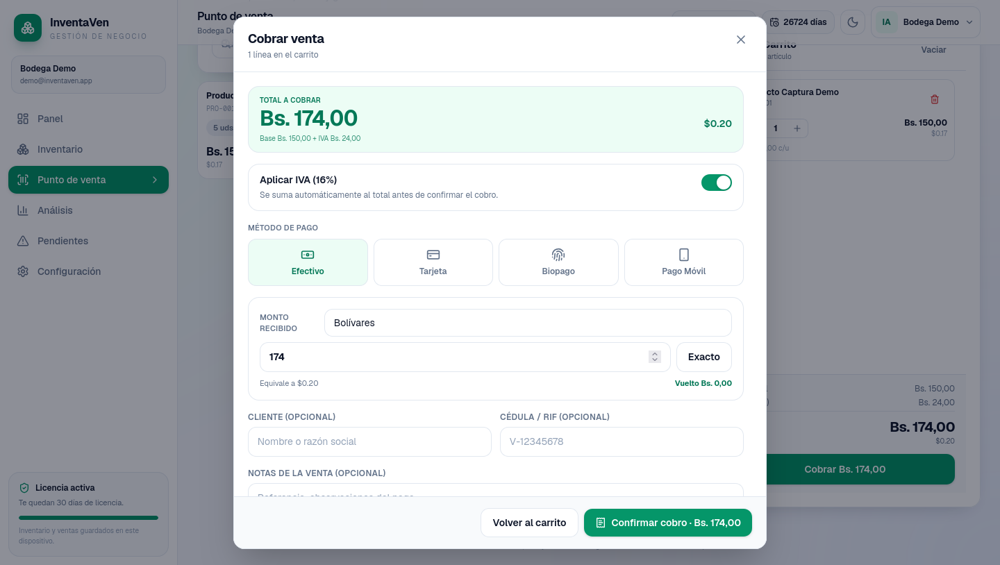
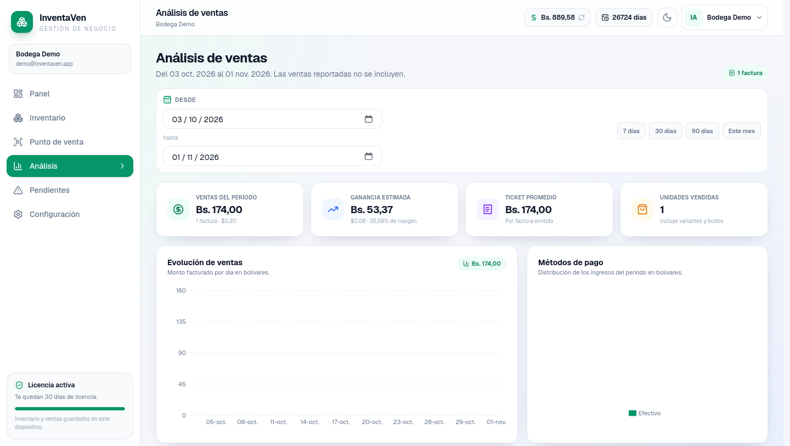

# InventaVen User

InventaVen User es la aplicacion web de gestion comercial del negocio: inventario, punto de venta, analisis de ventas, ventas pendientes y configuracion.










## Funcionalidades

- Gestion de inventario con productos, variantes y alertas de stock.
- Punto de venta con carrito, descuentos, IVA automatico y cobro.
- Analisis de ventas con metricas en VES y USD, incluida la ganancia estimada.
- Ventas pendientes con renovar, restablecer, editar y eliminar.
- Configuracion de seguridad y datos.

## Stack

- Next.js, React, Tailwind CSS.
- Dexie e IndexedDB para datos locales.
- Supabase para autenticacion y licencias.
- Sonner, Recharts y Lucide React.

## Puesta en marcha

```bash
npm install
npm run dev
```

## Variables de entorno

- `NEXT_PUBLIC_SUPABASE_URL`
- `NEXT_PUBLIC_SUPABASE_ANON_KEY`
- `SUPABASE_SERVICE_ROLE_KEY`
- `EXCHANGERATE_API_KEY`
- `NEXT_PUBLIC_APP_URL`
- `CAPTCHA_SECRET`

## Seguridad y datos

- Los datos operativos se guardan localmente en el dispositivo.
- Las credenciales y la llave de servicio viven solo en el entorno del servidor.
